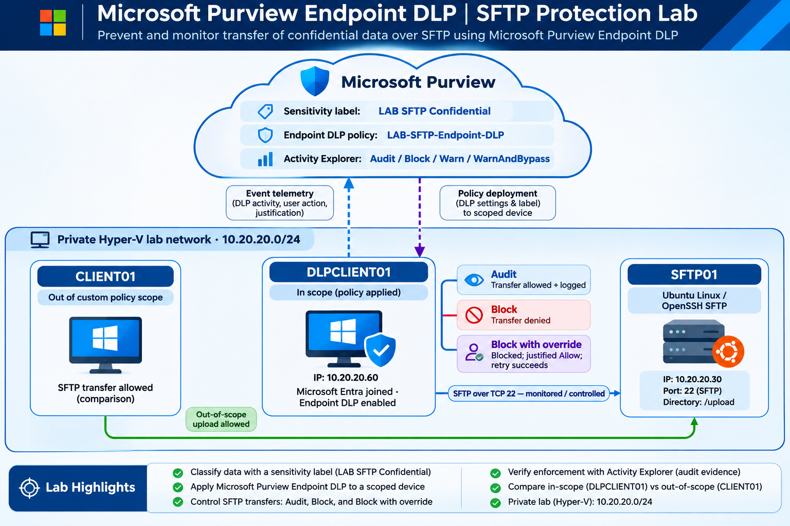

# Microsoft Purview Endpoint DLP — FTP/SFTP Data Exfiltration Controls

> **Hands-on security engineering portfolio lab** · Microsoft Purview · Endpoint DLP · Sensitivity labels · Windows 11 · SFTP · Audit investigation

# Microsoft Purview Endpoint DLP — SFTP Protection Lab

**Scoped Sensitivity Labels, FTP/SFTP Controls, Auditable Overrides, and Endpoint Investigation in a Shared Microsoft 365 Tenant**

I designed, configured, and validated a Microsoft Purview Endpoint Data Loss Prevention (DLP) pilot for **sensitivity-labeled Word documents** in an isolated Hyper-V environment. I tested **Audit only**, **Block**, and **Block with override** on `DLPCLIENT01`, then compared a transfer from `CLIENT01`, which was outside the selected device scope. I correlated the results with Microsoft Purview Activity Explorer instead of relying on configuration status alone.

> **Lab flow:** Classify → Scope → Audit → Block → Compare Scope → Override → Investigate → Plan Rollback

## At a Glance

| Area | Result |
|---|---|
| Pilot boundary | Selected test user **AND** the selected `DLPCLIENT01` device |
| Classification | `LAB SFTP Confidential` sensitivity label on fictional Word documents |
| Test infrastructure | Hyper-V Windows 11 clients and Ubuntu OpenSSH SFTP server (`10.20.20.0/24`) |
| Audit only | Upload permitted; Purview activity reported **Audit** |
| Block | Upload denied; destination file absent; Purview reported **Block** |
| Block with override | Initial restriction (**Warn**), justification and Allow, successful retry (**WarnAndBypass**) |
| Out-of-scope comparison | `CLIENT01` successfully uploaded; consistent with custom device scoping |
| Evidence | 14 curated screenshot images and a standalone architecture diagram |

**Contents:** [Problem](#the-problem-this-lab-solves) · [Objectives](#project-objectives) · [Environment](#lab-environment) · [Architecture](#architecture-and-logical-workflow) · [Implementation](#implementation) · [Validation](#validation-results) · [Troubleshooting](#troubleshooting-and-key-lessons) · [Rollback](#rollback-plan--shared-tenant-and-reusable-lab-vms) · [Skills](#skills-demonstrated)

---
## The Problem This Lab Solves

Organizations need to prevent classified information from leaving managed workstations through FTP/SFTP, while supporting controlled exceptions and maintaining an audit trail. Overly broad DLP deployment risks disrupting legitimate work; insufficiently scoped policies can leave unexpected gaps. This lab evaluates both sides with a **selected-device policy**, an **out-of-scope comparison**, and three enforcement modes backed by transfer logs and centralized events.

---
## Project Objectives

- Publish and apply a confidential sensitivity label only to the test identity.
- Configure FTP/SFTP endpoint restrictions using an explicit user-and-device scope.
- Demonstrate **Audit**, **Block**, and **Block with override** on a managed Windows endpoint.
- Compare behavior on a separate, onboarded but out-of-scope Windows client.
- Investigate **Audit**, **Block**, **Warn**, and **WarnAndBypass** in Activity Explorer.
- Preserve sanitized evidence and document a shared-tenant-safe rollback procedure.

---
## Tools and Services Used

Microsoft Purview Information Protection and Endpoint DLP · Microsoft Purview Activity Explorer · Microsoft Entra ID · Windows 11 Enterprise · Microsoft Defender endpoint monitoring · Hyper-V · Ubuntu Linux/OpenSSH · Windows PowerShell and OpenSSH `sftp.exe`

---
## Lab Environment

| Resource | Purpose |
|---|---|
| Shared Microsoft 365 test tenant | Lab policy and published sensitivity label, scoped to test identity |
| `DLPCLIENT01` (`10.20.20.60`) | Entra-joined, monitored Windows 11 endpoint; in scope |
| `CLIENT01` (`10.20.20.50`) | Comparison Windows 11 endpoint; not selected in custom policy scope |
| `SFTP01` (`10.20.20.30`) | Ubuntu OpenSSH/SFTP endpoint serving `/upload` on TCP port 22 |
| `LAB SFTP Confidential` | Sensitivity label applied to fictional Word documents |
| `LAB-SFTP-Label-Publish` | Publishing policy targeting the designated test user |
| `LAB-SFTP-Endpoint-DLP` | Endpoint DLP policy controlling FTP/SFTP activity |
| `Confidential-SFTP-Transfer` | Rule matching the sensitivity label and specified file activity |

> All content is fictional test data. The SFTP server was on a **private Hyper-V network**, not a public internet destination. This pilot does not claim coverage of every application or exfiltration pathway.

---
## Related Microsoft 365 Security Labs

| Lab | Project | Focus |
|---|---|---|
| Identity | [Microsoft Entra Identity Security Lab](https://github.com/kingsrule50/m365-entra-identity-security-lab) | Conditional Access, authentication, identity controls |
| Data protection | [Microsoft Purview Data Protection Lab](https://github.com/kingsrule50/m365-purview-data-protection) | Classification, DLP and retention governance |
| **Endpoint DLP (this lab)** | **SFTP Protection Lab** | Scoped device enforcement, FTP/SFTP auditing and justified overrides |

---
## Architecture and Logical Workflow

[](architecture.png)

*Figure: Microsoft Purview publishes the targeted classification/DLP configuration to DLPCLIENT01 and receives activity telemetry. The two Windows clients connect to SFTP01 inside the private Hyper-V lab; CLIENT01 is not selected by this custom policy.*

<details>
<summary>Text-only architecture (accessible alternative)</summary>

```text
         Microsoft Purview (shared Microsoft 365 test tenant)
            ├── Sensitivity label: LAB SFTP Confidential
            ├── Label publication: LAB-SFTP-Label-Publish
            └── DLP policy: LAB-SFTP-Endpoint-DLP
                    └── Rule: Confidential-SFTP-Transfer
                          Selected user AND DLPCLIENT01

  Hyper-V private network (10.20.20.0/24)
  ┌──────────────────────────────────┐
  │ DLPCLIENT01  10.20.20.60        │  Entra joined; targeted DLP endpoint
  │ labeled Word file + sftp.exe     ├──────── SFTP TCP/22 ────────┐
  └──────────────────────────────────┘                              │
  ┌──────────────────────────────────┐                ┌─────────────▼─────────────┐
  │ CLIENT01  10.20.20.50           │                │ SFTP01  10.20.20.30     │
  │ onboarded; not in selected scope├────────────────► Ubuntu / OpenSSH SFTP    │
  └──────────────────────────────────┘                │ remote directory /upload │
                                                      └───────────────────────────┘
```

</details>

| Component | Lab configuration |
|---|---|
| Managed source | Windows 11 `DLPCLIENT01`, Entra joined, Endpoint DLP enabled |
| Comparison source | Windows 11 `CLIENT01`, onboarded but not selected in this custom device scope |
| Destination | Ubuntu `SFTP01`, OpenSSH SFTP at `10.20.20.30:22`, directory `/upload` |
| Data classification | `LAB SFTP Confidential` sensitivity label |
| Publishing policy | `LAB-SFTP-Label-Publish`, scoped to the test account |
| DLP policy and rule | `LAB-SFTP-Endpoint-DLP` / `Confidential-SFTP-Transfer` |
| DLP condition | **Content contains → Sensitivity labels → LAB SFTP Confidential** |
| Location/scope | **Devices**; the selected test user **AND** selected `DLPCLIENT01` |
| Activity controlled | **FTP and SFTP transfers** |
| Monitoring | Microsoft Purview **Activity Explorer** and endpoint policy notifications |

The private IP addresses, resource names, and account labels are training identifiers. Account email addresses and unrelated tenant identifiers have been obscured in the published screenshots.

---
## Implementation

### 1. Publish the Label and Scope the Policy

1. Create or select the sensitivity label `LAB SFTP Confidential` in Microsoft Purview.
2. Target only the designated lab user in publishing policy `LAB-SFTP-Label-Publish`.
3. Configure `LAB-SFTP-Endpoint-DLP`, choosing **Devices** as the DLP location.
4. Under device targeting, select the test user **AND** `DLPCLIENT01`; leave `CLIENT01` unselected.
5. Add a rule with **Content contains → Sensitivity labels → LAB SFTP Confidential**.
6. Select **File activities for all apps → FTP and SFTP transfers** and test enforcement modes in separate phases.
7. Publish the policy and confirm the relevant endpoint policy has synchronized before each enforcement test.

**Evidence:** [Label publishing review](evidence/01-label-publishing-policy.png) · [Selected user + device](evidence/02-targeted-policy-scope.png) · [Confidential document](evidence/03-labeled-test-document.png)

**Evidence qualification:** The label-publishing image is a **review/setup** screen; it is not, by itself, proof of successful publication. The rule and scope screenshots likewise show configuration, while endpoint and Activity Explorer records below demonstrate actual enforcement.

### 2. Audit-only Phase — Observe Without Interrupting Transfer

Set **FTP and SFTP transfers → Audit only**, publish, confirm synchronization, and test a labeled Word file from `DLPCLIENT01`:

```powershell
sftp dlpuser@10.20.20.30
```

At the interactive `sftp>` prompt:

```text
put "Documents/DLP-SFTP-Lab/Confidential-SFTP-Audit-Test02.docx" Confidential-SFTP-Audit-Test02.docx
ls -l Confidential-SFTP-Audit-Test02.docx
```

**Observed:** The SFTP client reported **100% transfer**, the destination listing included the file, and Activity Explorer recorded a **File transferred by FTP** event with **Enforcement mode: Audit** and the expected label/policy/rule. This test occurred November 16, 2026, at approximately **4:47 PM Eastern**.

**Evidence:** [Audit configuration](evidence/04-audit-only-rule.png) · [SFTP successful upload](evidence/05-audit-sftp-upload.png) · [Purview Audit event](evidence/06-purview-audit-event.png)

### 3. Block Phase — Stop the Matching Upload

Change the same FTP/SFTP action to **Block**, publish, and validate with a separate labeled file:

```text
put "Documents/DLP-SFTP-Lab/Confidential-SFTP-Block-Test.docx" Confidential-SFTP-Block-Test.docx
ls -l
```

**Observed:** The client returned `open local ... Unknown error`; Windows displayed a **Data Loss Prevention** notification saying the upload was not permitted. The destination directory did **not** contain the specifically named test file. Activity Explorer reported **Enforcement mode: Block**, matching policy and rule, at **8:36 PM Eastern on November 16, 2026**.

Note that an older, **similarly named** file (`Confidential-Block-Test.docx`) appeared in the directory. It was **not** the blocked target (`Confidential-SFTP-Block-Test.docx`).

**Evidence:** [Block configuration](evidence/07-block-rule.png) · [Blocked upload and notification](evidence/08-block-sftp-denied.png) · [Purview Block event](evidence/09-purview-block-event.png)

### 4. Out-of-scope Comparison — CLIENT01

The custom rule selected **the test user AND DLPCLIENT01**. `CLIENT01` was onboarded but was not the device selected by that rule. An SFTP transfer initiated on `CLIENT01` completed at **100%**, and the remote file appeared in the directory listing.

This is an **observed scope comparison**, consistent with the custom Block rule not applying to this client; it does **not** establish that no other DLP controls or policies exist on `CLIENT01`.

**Evidence:** [Scope selection](evidence/02-targeted-policy-scope.png) · [CLIENT01 successful transfer](evidence/10-client01-out-of-scope-upload.png)

### 5. Block with Override — Controlled Exception and Justification

For the last phase, set **FTP and SFTP transfers → Block with override**. Enable endpoint **policy-tip notifications** and select **Require a business justification to override**. Publish the changes and confirm endpoint synchronization. Use a fresh labeled test file (`Confidential-SFTP-Override-Test02.docx`).

```text
put "Documents/DLP-SFTP-Lab/Confidential-SFTP-Override-Test02.docx" Confidential-SFTP-Override-Test02.docx
```

**Observed sequence:**

1. **Initial attempt denied:** `sftp.exe` returned `open local ... Unknown error`; the endpoint displayed a DLP notification offering **Allow**.
2. **Justification provided:** The user selected **Other** and entered an explanation indicating an authorized Endpoint DLP test with fictional data.
3. **Override approved:** After selecting **Allow**, the user retried the same `put` command.
4. **Retry succeeded:** The client reported **100% transfer**. Remote `ls -l` confirmed `Confidential-SFTP-Override-Test02.docx`, **39,778 bytes**.
5. **Centralized audit recorded:** At **8:05 PM Eastern, November 17**, Activity Explorer recorded **Warn** for the initial rule match. At **8:15 PM Eastern**, the **File transferred by FTP** event recorded **WarnAndBypass** and included the submitted reason.

**Evidence:** [Justification before Allow](evidence/12-override-justification-dialog.png) · [Successful retry + remote listing](evidence/13-override-authorized-upload.png) · [Initial Warn event](evidence/14-purview-initial-warn.png) · [WarnAndBypass transfer](evidence/15-purview-warn-and-bypass-transfer.png)

---
## Validation Results

| Test | Expected | Observed | Source evidence |
|---|---|---|---|
| Audit only, in-scope endpoint | Permit and audit | 100% upload; **Audit** event | 04–06 |
| Block, in-scope endpoint | Deny and audit | Failed upload; DLP notification; **Block** event | 07–09 |
| Comparison client outside selected scope | Custom rule does not target that device | 100% upload and destination listing | 02, 10 |
| Block with override, before approval | Restrict and prompt | Failed initial upload; **Warn** event | 12, 14 |
| Block with override, after approval | Permit retry, log reason | 100% retry; file present; **WarnAndBypass** + justification | 12–13, 15 |

---
## Troubleshooting and Key Lessons

- **Configuration is not the same as enforcement.** A cloud policy showing *Sync completed* and a device showing *Updated* are useful health indicators, but only a controlled transfer plus matching audit records established the enforcement state.
- **An earlier override attempt uploaded without a prompt.** Activity Explorer recorded that transfer as **Audit** and showed **no matched custom rule**. The evidence did not establish a definitive root cause. After reviewing rule condition, scope, notifications, and synchronization, a **new labeled test file** was blocked initially and successfully overridden with justification.
- **Use the intended source VM.** An attempted test from `SFTP01` failed with *No such file or directory* because the confidential document resided on `DLPCLIENT01`. Initiate the protected transfer from the managed source device.
- **The event name does not prove delivery.** Activity Explorer can label an event **File transferred by FTP** even when the corresponding enforcement mode is **Block** or **Warn**. Confirm actual delivery with the endpoint result and remote listing.
- **Track exact filenames.** A remote file with a similar name from a previous test is not evidence that a newly blocked attempt succeeded.
- **Business justification is an audit control, not blanket authorization.** The allowed retry demonstrated the configured exception path in this bounded lab; a production decision needs appropriate access, monitoring, and review controls.

---
## Rollback Plan — Shared Tenant and Reusable Lab VMs

The lab was operated in a **shared** Microsoft 365 environment. Rollback should target only the lab's own objects and be performed **after** saving screenshots and logs:

1. Inventory `LAB-SFTP-Endpoint-DLP`, `LAB-SFTP-Label-Publish`, `LAB SFTP Confidential`, and the selected lab account; check whether **any other project** depends on them.
2. Disable the lab DLP policy (or delete it if authorized and uniquely owned), and confirm the intended policy change is reflected. Do not delete unrelated tenant-wide DLP rules.
3. Remove only the lab-specific label publishing policy if it is no longer referenced; remove the sensitivity label only after checking for files and other policies that use it. Label removal does not automatically undo classification of existing files.
4. Remove fictional transfer files from the test endpoint and SFTP `/upload` directory **only after confirming exact names**. Preserve unrelated files and server accounts.
5. Retain shared Hyper-V VMs, virtual switches, Defender onboarding, and other reusable infrastructure unless separately authorized for decommissioning.
6. Recheck the targeted tenant configuration and preserve the published, sanitized portfolio evidence.

**Rollback status:** This README documents the rollback **procedure**; it does not claim that the tenant cleanup has already been carried out.

---
## Evidence and Privacy

All evidence under [`evidence/`](evidence/) is drawn from actual lab screenshots and flattened as public-facing image derivatives. Tenant email addresses and selected identifiers have been visually obscured in the curated screenshots; private lab addressing and policy/rule names are retained to make tests reproducible. Perform a final privacy review of all public screenshots before publishing.

---
## Skills Demonstrated

**Microsoft Purview Endpoint DLP · Microsoft 365 compliance configuration · sensitivity labels · policy scope and propagation · Windows endpoint security · Linux/OpenSSH SFTP · PowerShell · controlled validation · Activity Explorer investigations · business justification auditing · documented rollback**


---
## Repository Structure

```text
purview-endpoint-dlp-sftp-portfolio/
├── README.md
├── architecture.png            # Illustrated architecture with device/cloud icons
├── evidence/
│   ├── README.md               # Evidence index and interpretation
│   └── *.png                   # 14 selected, redacted screenshot files
└── .gitignore
```

---
## Portfolio Note

This is a hands-on security engineering demonstration using fictional documents and reusable lab resources. **Audit logs and endpoint transfer outcomes are evidence of the tested scenarios, not a production security certification.** The rollback steps are documented but have not been executed as part of this published evidence.
