# Microsoft Purview Endpoint DLP — SFTP Data Protection Lab

**Microsoft Purview | Endpoint DLP | Sensitivity Labels | SFTP Security | Data Exfiltration Prevention**

## Project Overview

In October 2026, Microsoft announced the general availability of **FTP/SFTP transfer protection in Microsoft Purview Endpoint DLP**.

I built this lab to test the new capability in a controlled environment and demonstrate how organizations can monitor, restrict, and investigate transfers of sensitive documents.

Using Windows 11, Microsoft Purview, and an Ubuntu SFTP server, I configured and validated **Audit only, Block, and Block with override**, including business justification and centralized investigation.

**Microsoft reference:** [FTP/SFTP protection in Endpoint DLP](https://learn.microsoft.com/en-us/purview/endpoint-dlp-ftp-sftp-short)

---

## At a Glance

| Test Scenario | Verified Outcome |
|---|---|
| Audit only | Transfer allowed; DLP activity recorded |
| Block | Transfer prevented; DLP notification displayed |
| Block with override | Initially blocked; approved retry succeeded |
| Out-of-scope CLIENT01 | Transfer allowed outside the custom device scope |
| Activity Explorer | Audit, Block, Warn, and WarnAndBypass verified |

## Lab Environment

| Component | Configuration |
|---|---|
| Microsoft Purview | Sensitivity labels, Endpoint DLP, Activity Explorer |
| DLPCLIENT01 | Windows 11, Entra joined, in scope — `10.20.20.60` |
| CLIENT01 | Windows 11, outside custom device scope — `10.20.20.50` |
| SFTP01 | Ubuntu/OpenSSH — `10.20.20.30:22` |
| Sensitivity label | `LAB SFTP Confidential` |
| DLP policy | `LAB-SFTP-Endpoint-DLP` |
| DLP rule | `Confidential-SFTP-Transfer` |
| Network | Private Hyper-V network — `10.20.20.0/24` |

## Architecture

I configured a private Hyper-V environment with two Windows endpoints and an Ubuntu SFTP server. I applied the custom DLP policy to DLPCLIENT01 and used CLIENT01 to compare out-of-scope behavior.


---

## Implementation and Validation

### 1. Sensitivity Label and Policy Configuration

I published the `LAB SFTP Confidential` sensitivity label to a designated test user and configured the DLP policy to target that user **AND** DLPCLIENT01.

I deliberately excluded CLIENT01 from the custom device scope.

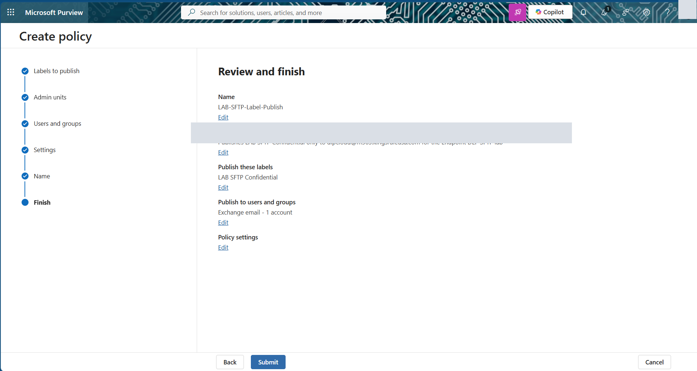

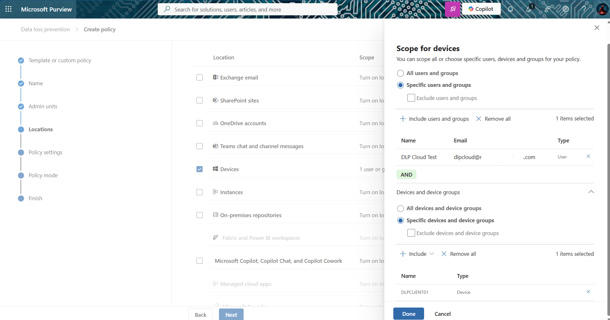

I then applied the sensitivity label to a fictional Microsoft Word document.

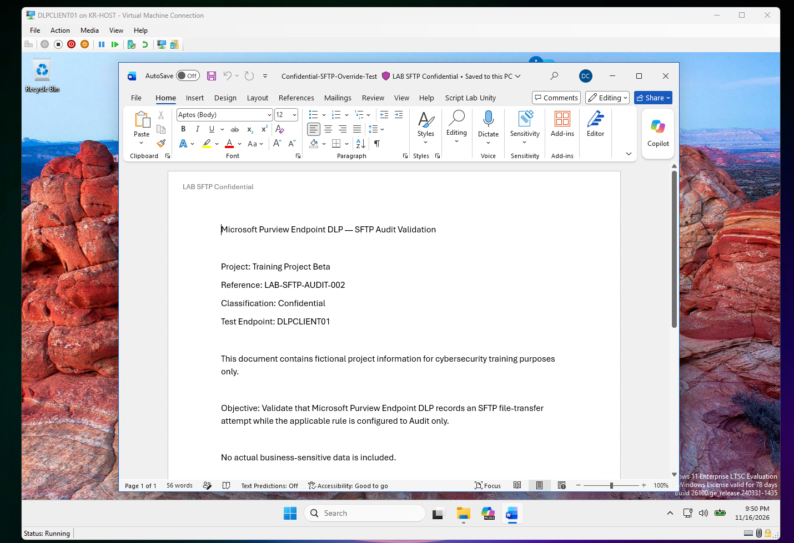

**Result:** I verified that the label was available in Word and matched the DLP rule condition.

### 2. Audit Only — Monitoring SFTP Transfers

I configured **FTP and SFTP transfers → Audit only** to monitor confidential file transfers without preventing them.

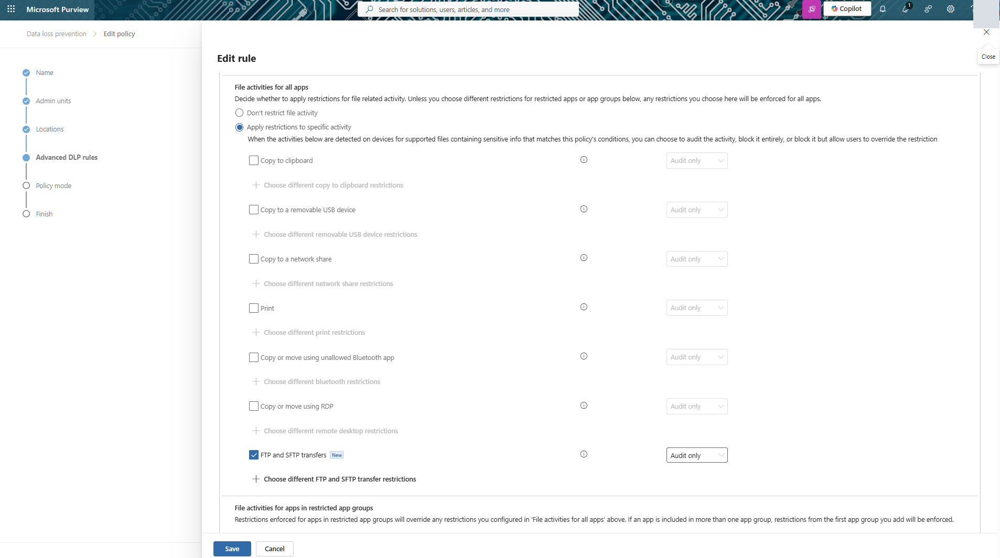

From DLPCLIENT01, I connected to SFTP01:

```powershell
sftp dlpuser@10.20.20.30
```

I uploaded the labeled document:

```text
put "Documents/DLP-SFTP-Lab/Confidential-SFTP-Audit-Test02.docx" Confidential-SFTP-Audit-Test02.docx
```

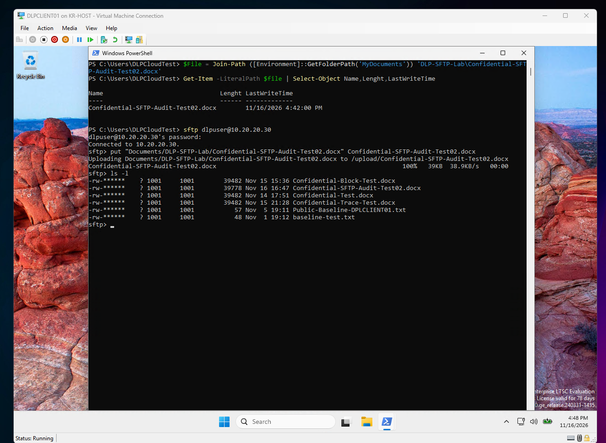

**Result:** The transfer completed at **100%**, and the destination file was confirmed. Microsoft Purview Activity Explorer recorded the transfer with **Enforcement mode: Audit**.

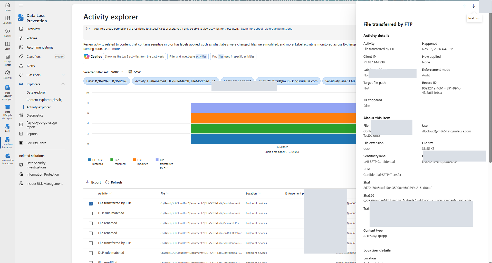

### 3. Block — Preventing Confidential Data Transfers

I changed the FTP/SFTP enforcement action to **Block** and tested another sensitivity-labeled document.

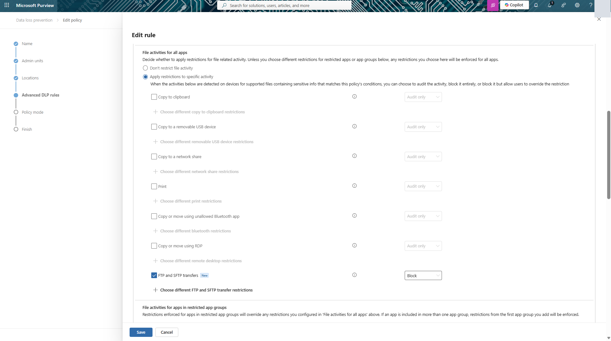

```text
put "Documents/DLP-SFTP-Lab/Confidential-SFTP-Block-Test.docx" Confidential-SFTP-Block-Test.docx
```

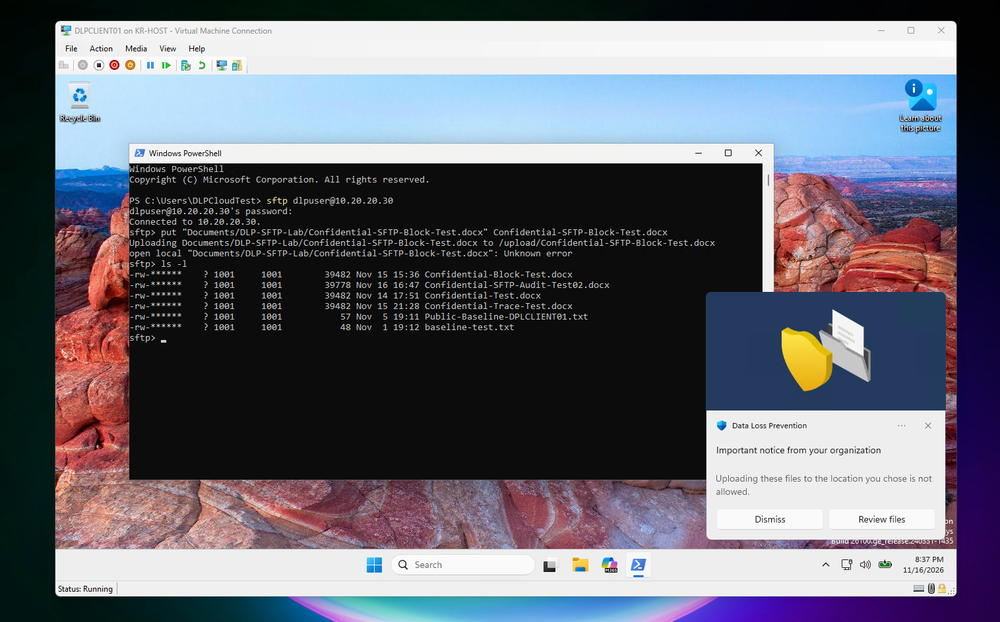

**Result:** The upload failed, a Microsoft Purview DLP notification appeared, and the target document was absent from the destination directory.

Activity Explorer confirmed the matching policy and rule with **Enforcement mode: Block**.

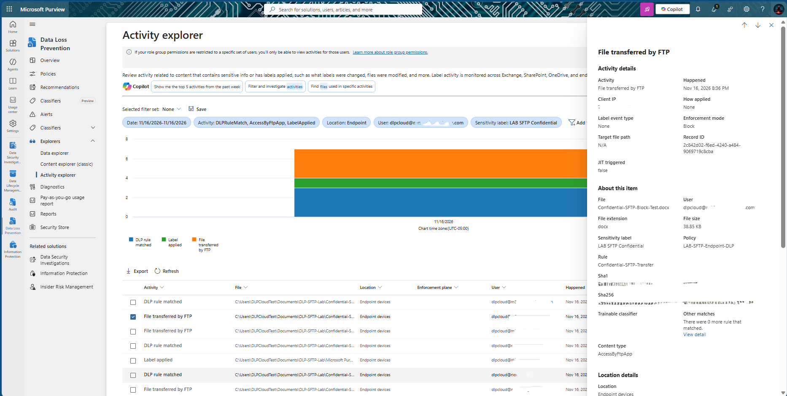

### 4. Out-of-Scope Endpoint Validation

I tested a separate Windows endpoint, CLIENT01, which was excluded from the custom DLP policy's selected device scope.

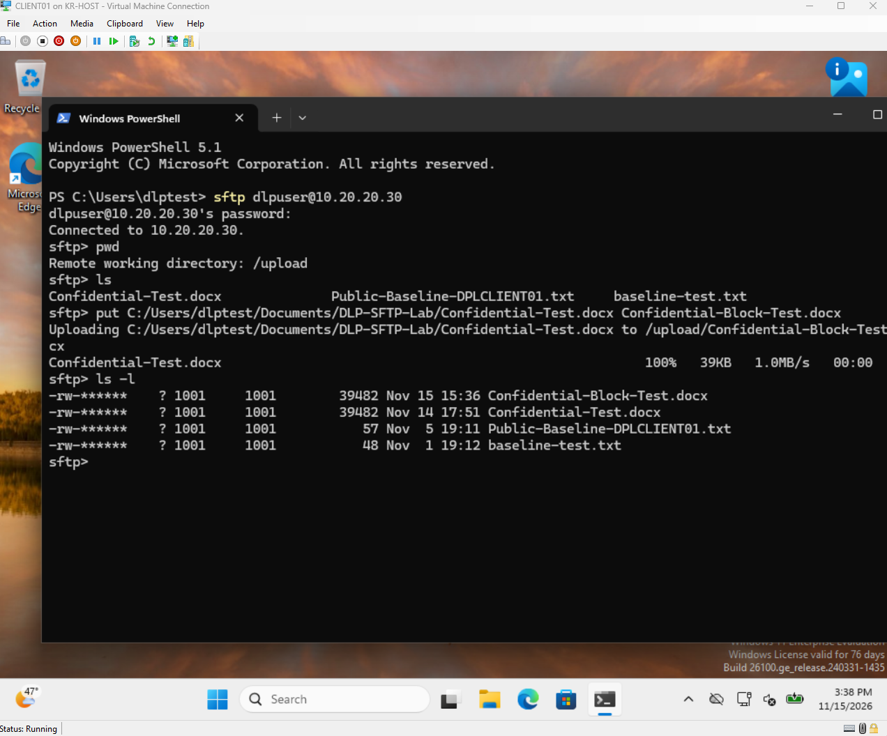

**Result:** The confidential test document transferred successfully.

This was consistent with CLIENT01 being outside the custom policy's device scope and demonstrated the importance of correct user and device targeting. It did not establish that CLIENT01 lacked other security protections.

### 5. Block with Override — Business Justification

I changed FTP/SFTP enforcement to **Block with override**, enabled endpoint notifications, and required users to provide a business justification.

I attempted to upload `Confidential-SFTP-Override-Test02.docx`.

**Initial result:** The upload failed, and Microsoft Purview displayed an override prompt.

I selected **Other** and entered an authorized lab-testing justification.

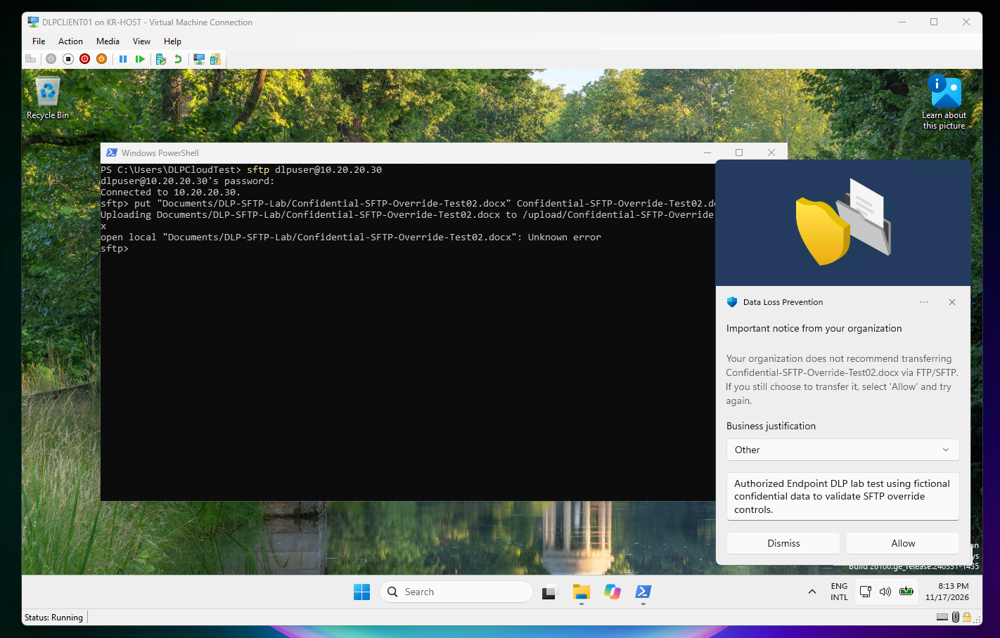

After selecting **Allow**, I retried the SFTP upload.

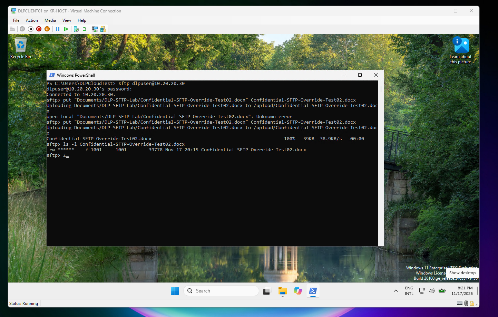

**Result:** The retry succeeded at **100%**, and the remote directory confirmed the uploaded file.

### 6. Activity Explorer — Investigating the Override

I investigated the events in Microsoft Purview Activity Explorer to confirm that both the restriction and the user-authorized exception were recorded.

**Initial attempt — Warn**

Activity Explorer recorded the matching DLP rule with **Enforcement mode: Warn**.

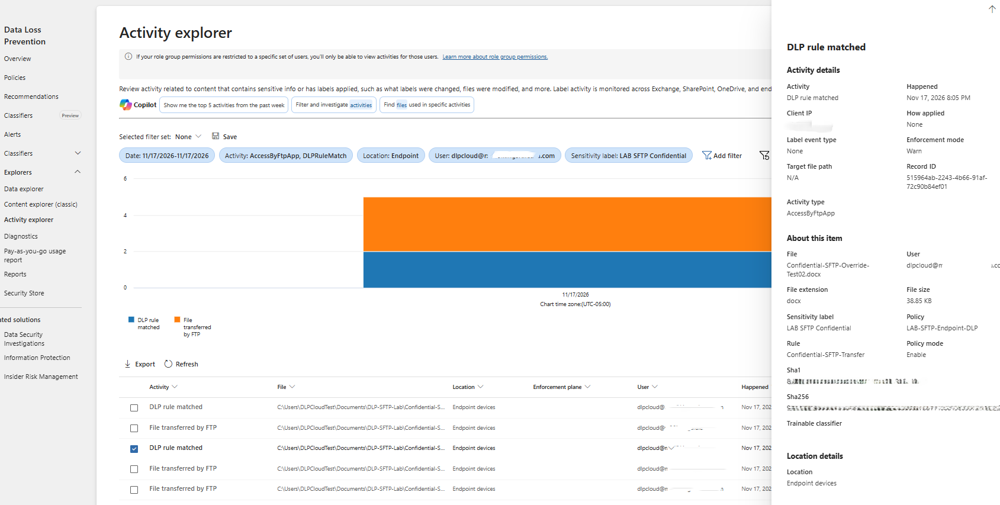

**Authorized retry — WarnAndBypass**

Following the user's approval, Activity Explorer recorded **Enforcement mode: WarnAndBypass**, including the submitted business justification.

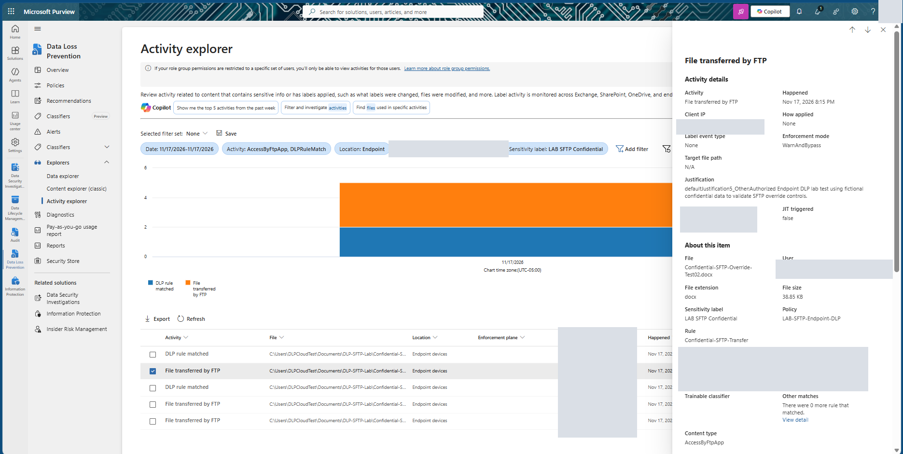

**Result:** I correlated the initial restriction, user justification, authorized retry, and successful SFTP delivery with Microsoft Purview's centralized audit records.

---

## Validation Results

| Scenario | Actual Result | Status |
|---|---|---|
| Sensitivity label | Applied and verified in Word | PASS |
| Audit only | Upload allowed; Audit event recorded | PASS |
| Block | Upload denied; Block event recorded | PASS |
| Out-of-scope CLIENT01 | Upload succeeded outside selected device scope | OBSERVED |
| Block with override | Initial restriction; justified retry succeeded | PASS |
| DLP investigation | Warn and WarnAndBypass events verified | PASS |

## Key Lessons Learned

1. **Policy scoping matters.** I confirmed that targeting the correct user and device is essential for applying the intended protection.
2. **Configuration does not equal enforcement.** I validated policy behavior using actual transfer results, DLP notifications, and Activity Explorer rather than relying on synchronization status alone.
3. **DLP overrides provide accountability.** I verified that Microsoft Purview can record user-authorized exceptions and their business justifications.

## Skills Demonstrated

- **Microsoft Purview Endpoint DLP:** Policy configuration, scoping, and enforcement
- **Information Protection:** Sensitivity labels and publishing policies
- **DLP Investigation:** Activity Explorer, audit events, and policy-rule correlation
- **Security Controls:** Audit, Block, and Block with override
- **Windows PowerShell / SFTP:** Transfer testing and validation
- **Endpoint Security:** Entra-joined devices and controlled exfiltration testing

 
---

## Portfolio Note

I built this project to demonstrate,implement and validate a newly available Microsoft Purview security capability.

**I successfully tested FTP/SFTP monitoring, enforcement, justified user overrides, and centralized DLP investigation using a controlled Hyper-V environment and fictional confidential data.**

The project represents hands-on security engineering experience, not a production deployment.

